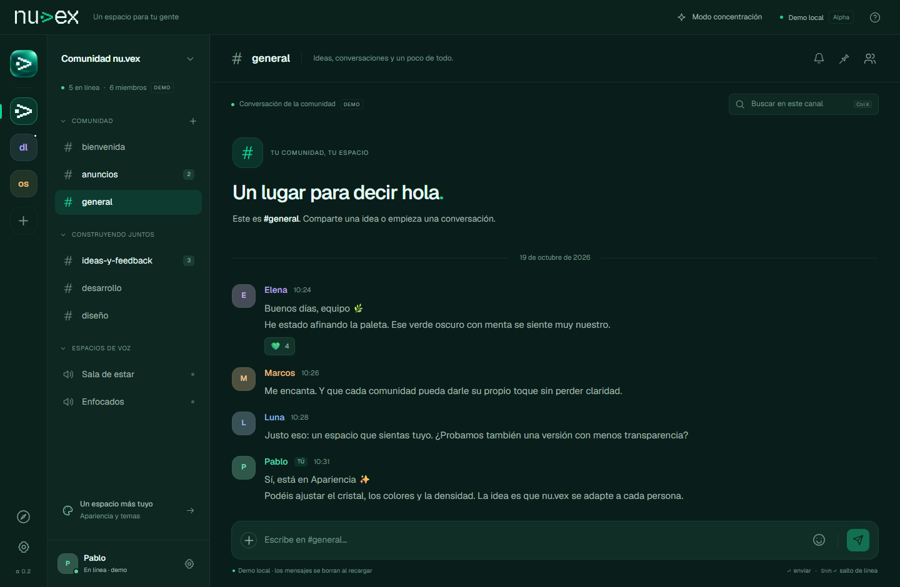

# nu.vex

**Tu gente. Tu espacio. Tu servidor.**

Comunicación para comunidades, equipos y empresas, creada por **Pablo ([ImPaul17](https://github.com/ImPaul17))**. Elige una instancia de confianza o aloja la tuya. Código y marca originales bajo [Apache-2.0](LICENSE).

Español es el idioma principal. [English documentation](docs/en/README.md).



## Pruébalo

El cliente web funciona en escritorio y móvil. En `/demo` puedes explorar comunidades, enviar mensajes locales y personalizar el entorno sin crear una cuenta. La demo se reinicia al recargar.

El despliegue propio en **Cloudflare Workers**, con dirección `workers.dev`, está pendiente de autenticación y publicación. La ruta preferida conecta el cliente con Axum/PostgreSQL en el PC mediante un túnel privado y Workers VPC. Mientras el servicio esté en el PC, este debe permanecer encendido y conectado. Su base PostgreSQL será independiente de las bases de pruebas. El alojamiento anterior de ChatGPT Sites se descarta por decisión del usuario; todavía no hay una nueva URL de Cloudflare verificada. Consulta [el plan de despliegue](docs/web-deployment.md).

Las cuentas y el historial compartido necesitan un **servidor nu.vex**. Los instaladores de Windows, Linux y macOS están en [Releases](https://github.com/ImPaul17/nu.vex/releases). La versión publicada de referencia es **v0.2.0-alpha.6**; los cambios de esta rama todavía no forman parte de ese instalador.

**Todas las publicaciones se mantienen como pre-release Alpha.** No se presenta como estable ninguna función en desarrollo.

## Qué puedes hacer

| Capacidad | Estado |
| --- | --- |
| Crear cuenta e iniciar/cerrar sesión | Implementado por instancia, con correo y contraseña |
| Crear comunidades y canales de texto | Implementado; permisos de propietario en el servidor |
| Invitar a otra cuenta de la instancia | Implementado mediante códigos de invitación |
| Enviar y borrar tus mensajes, historial y reconexión | Implementado con PostgreSQL y WebSocket |
| Guardar y cambiar de instancia | Hasta seis direcciones; varias sesiones en memoria en web. Escritorio: una conexión por ventana |
| Buscar en el historial cargado | Implementado en el cliente |
| Interfaz móvil, categorías plegables y concentración | Implementado en el cliente compartido |
| Temas, acento, transparencia, densidad, importar/exportar JSON | Implementado; preferencias locales sin scripts |
| Instancia oficial y comunidad de nu.vex | Pendiente de desplegar el servidor central y su operación |
| Privados, amistades, roles personalizados y moderación avanzada | Planificados; aún no disponibles |
| Voz, vídeo, subida y visualización de archivos compartidos | Planificados; la demo de adjuntos solo muestra metadatos |
| Inicio con proveedores externos, varias cuentas de una misma instancia | Planificado |
| Actualización automática de Windows, apps Android/iOS | Planificado; la web adaptable ya se puede usar en móvil |
| Catálogo comunitario de temas, bots y federación | Planificado; las instancias actuales son independientes |

En web, cambiar de instancia conserva la sesión en memoria. En escritorio se requiere iniciar sesión de nuevo al cambiar. **Cerrar sesión** revoca solamente la cuenta de la instancia actual. Las contraseñas y tokens no se guardan en `localStorage`; allí solo se conservan direcciones y apariencia. Después de recargar, las sesiones remotas necesitan un nuevo inicio de sesión. Cada servidor externo también debe aceptar el origen del cliente y la política de conexión del despliegue.

## Desarrollo local

Requisitos: Node.js 22.14+ en la línea 22, o 24+; npm `>=11.18 <12`. El gestor fijado es npm 11.21.1.

```sh
npx --yes npm@11.21.1 ci
npm run dev
```

Abre `http://127.0.0.1:5173/demo` para la demostración o `/` para una instancia real. El proxy de desarrollo dirige `/api` a `127.0.0.1:3001`.

Para las cuentas reales necesitas PostgreSQL y el backend. Sigue [autoalojamiento](docs/self-hosting.md) y el [servidor](apps/server/README.md). Para ejecutar el escritorio, sigue [la guía de escritorio](docs/desktop.md).

```sh
npm run check          # Svelte y TypeScript estricto
npm test               # node:test mediante tsx, modelos y temas
npm run build          # Cliente de producción en apps/web/build
npm run test:e2e        # Playwright: demo
npm run test:instance   # Playwright: servidor real en ejecución
```

En Windows, si no está instalado Chromium de Playwright, puedes usar Edge: `$env:PLAYWRIGHT_CHANNEL='msedge'`. [Pruebas y verificaciones](docs/testing.md) explica requisitos y resultados ejecutados.

## Cómo se organiza

```text
apps/web/        Cliente SvelteKit + Svelte 5, compartido con escritorio
apps/desktop/    Contenedor Tauri 2 y transporte nativo restringido
apps/server/     Servidor Rust/Axum y migraciones PostgreSQL
packages/core/   Modelos, datos de demo, temas e instancias guardadas
packages/tokens/ Tipografía y variables de diseño
infra/           Contenedores, proxy, copia y restauración
tests/           Integración de navegador, seguridad y condiciones de carrera
docs/            Documentación principal en español
docs/en/         Documentación secundaria en inglés y referencias históricas
```

## Dirección del proyecto

nu.vex combinará una instancia oficial, gestionada por Pablo y la comunidad de nu.vex, con servidores independientes de comunidades y empresas. Una cuenta pertenece a su instancia. No existe todavía una identidad global ni un protocolo de federación entre servidores.

La [hoja de ruta](docs/roadmap.md) define entregables y criterios de aceptación para cuentas, moderación, comunicación, móvil, actualizaciones y el ecosistema comunitario. La [arquitectura](docs/architecture.md) explica lo implementado y lo previsto.

- [Índice de documentación](docs/README.md)
- [Cambios de interfaz y sesiones](docs/interface.md)
- [Despliegue propio en Cloudflare](docs/web-deployment.md)
- [Autoalojamiento y copias de seguridad](docs/self-hosting.md)
- [Estado de publicación y límites](docs/release-readiness.md)
- [Contribución y mantenimiento](CONTRIBUTING.md)
- [Seguridad](SECURITY.md)
- [Marca y atribución](docs/branding.md)

Pablo / ImPaul17 dirige y mantiene el repositorio principal. Durante la Alpha no se aceptan contribuciones externas de código; el enfoque comunitario se desarrollará con procesos de propuestas, moderación y revisión antes de abrir bots y temas. La licencia permite mantener forks independientes.

## Licencia y créditos

Creado por **Pablo · ImPaul17**. Conserva [LICENSE](LICENSE), [NOTICE](NOTICE) y los [avisos de terceros](THIRD_PARTY_NOTICES.md). Las fuentes Geist y Geist Pixel mantienen SIL OFL 1.1. Los textos originales de licencias y avisos jurídicos se preservan en su idioma original; una traducción explicativa no los sustituye. La licencia no concede derechos sobre la marca.
