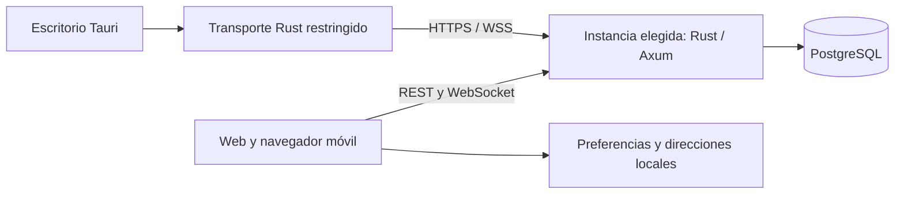

# Arquitectura

[Inicio](../README.md) · [English](en/README.md) · [Diseño técnico anterior completo](en/original/docs/architecture.md)

nu.vex es un cliente compartido y un servidor independiente por instancia. Creado y dirigido por Pablo / ImPaul17.

## Cliente compartido

`apps/web` usa SvelteKit, Svelte 5 y TypeScript estricto. La ruta `/` conecta con instancias reales; `/demo` usa datos efímeros de `packages/core`. `ChatShell.svelte` presenta comunidades, canales y mensajes; `InstanceApi` concentra validación de datos y operaciones del servidor. Los temas comparten variables de `packages/tokens` y solo admiten preferencias JSON validadas.

El escritorio incorpora el mismo cliente en Tauri 2. El transporte nativo restringe destinos y operaciones, verifica TLS y conserva tokens en memoria Rust. La [decisión ADR 0001](adr/0001-native-instance-transport.md) conserva el razonamiento del diseño.

## Ciclo de vida de varias instancias

En web, la ruta de acceso mantiene un máximo de seis conexiones durante la ejecución. El mediador de escritorio conserva una sola conexión por ventana y exige un nuevo inicio de sesión al cambiar. Cada conexión conserva sus propias credenciales. Al cambiar se cierra la suscripción activa, se invalida el trabajo pendiente de la sesión anterior y se obtiene de nuevo la cuenta, las comunidades y el historial del destino. Los mensajes anteriores se descartan del estado visible antes de cargar el siguiente servidor.

Solo hay una suscripción activa a la vez. Volver a una instancia recupera los eventos mediante el arranque de su espacio y la reconciliación del historial. No se reciben notificaciones en segundo plano de todas las instancias. Las credenciales remotas desaparecen al recargar; no se exportan junto con preferencias o direcciones.

Las direcciones recientes se validan y normalizan: HTTPS, HTTP solo local, sin credenciales, rutas, consultas ni fragmentos. Se guardan nombre, origen y fecha de uso. Una entrada dañada no bloquea las demás.

## Cuenta y autorización

Una cuenta pertenece a una instancia. El servidor registra y autentica con correo/contraseña, sesiones revocables e invitaciones. El propietario crea canales e invitaciones. Un miembro puede leer y enviar en sus comunidades y eliminar sus propios mensajes. La autorización se comprueba en Rust y PostgreSQL.

El navegador usa cookie en el mismo origen y token en memoria para instancias externas. CORS y la política de conexión del despliegue deben permitir el origen concreto. Tauri gestiona credenciales en su transporte nativo. Nunca se guardan contraseñas ni tokens en `localStorage`.

No hay todavía inicio con Discord u otros proveedores, vinculación entre cuentas, privados, amistades, roles personalizados ni un inicio global de Nuvex. Tendrán permisos y revocación propios.

## Persistencia y tiempo real

Axum y PostgreSQL mantienen el historial con orden estable y paginación por cursor. Los envíos incluyen un identificador de cliente para tolerar reintentos sin duplicar mensajes persistidos. Los eventos WebSocket usan tickets de corta duración y se reconcilian después de reconectar. El cliente protege la vista frente a respuestas tardías, sesiones sustituidas y mensajes ya borrados.

## Instancia oficial y autoalojamiento

El servicio central Alpha ejecuta el mismo servidor que las instalaciones independientes. La web está alojada en Cloudflare Workers; su binding VPC alcanza Axum en el PC mediante un túnel privado. PostgreSQL escucha solo en localhost, en un clúster de servicio separado de las pruebas. La [guía de despliegue](web-deployment.md) registra su URL y operación.

La comunidad oficial de Pablo sigue pendiente de configurar. Su diferencia será operativa: administración, admisión a la comunidad, cuotas, copias y moderación. Mientras el servidor esté en el PC, su disponibilidad depende de que permanezca encendido y conectado. La exportación estática del cliente no incluye PostgreSQL ni ejecuta Axum.

`compose.yaml` integra web, proxy, backend, migraciones y base privada. `infra` proporciona CSP y herramientas de copia/restauración. Claves, contraseñas y configuración se suministran por entorno. Consulta [autoalojamiento](self-hosting.md).

## Extensiones previstas

La voz Alpha usa una malla WebRTC de hasta ocho participantes. REST autentica la señalización y el WebSocket dirige señales a la sesión destinataria. Las participaciones son efímeras, con renovación y revisiones de lista que descartan eventos antiguos. El micrófono se libera antes de esperar a la red al abandonar. Consulta [el protocolo de voz](voice-server.md).

Archivos necesitarán almacenamiento autorizado y cuotas. La voz aún requiere TURN de producción y un SFU para ampliar conectividad y grupos. Vídeo, bots, temas comunitarios y actualizaciones firmadas conservan sus hitos en la hoja de ruta.

Cambiar entre instancias **no implementa federación**: hoy no hay comunicación entre sus servidores. La [hoja de ruta](roadmap.md) fija la aceptación de cada capacidad.
