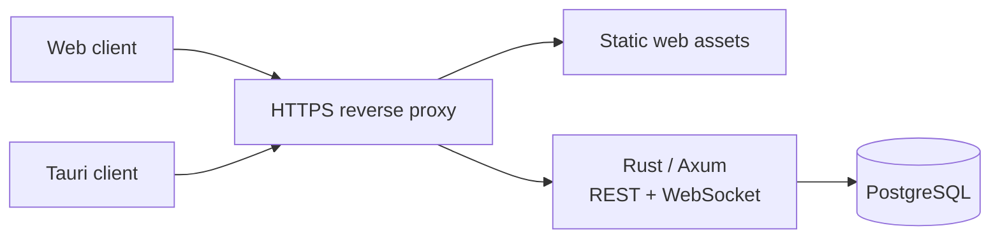

# Architecture

Status: phase 0/1 foundation followed by phase 2 implementation, 19 October 2026. The backend and infrastructure source now exist; implementation, verification, and public release are tracked separately in [release readiness](release-readiness.md). Design requirements below do not by themselves certify that a service has passed them.

## Existing workspace and milestone boundary

The initial workspace contained eight supplied brand files: `logo-app.svg`, `logo-app.png`, `logo-app.psd`, `logo-1.png`, `logo-1.psd`, `logo-2.png`, `logo-2.svg`, and `logo-2.psd`. No existing application, dependency manifest, or Git repository was present. Node 22.14.0 and npm 11.4.2 were available; Rust/Cargo and Docker were not exposed on `PATH`. Absence from `PATH` does not prove a tool is absent from the machine.

The initial implementation added a typed frontend and native shell scaffold. That explicit demo remains ephemeral and separate from real service-backed data. Subsequent work adds instance-owned accounts, PostgreSQL persistence, REST/WebSocket transport, and deployment files; the initial verification record remains historical.

The [environment inventory](environment.md) records the actual Rea integration and toolchain limits. The [branding record](branding.md) records asset inspection, exact frontend copies, and vendored font provenance.

## Repository boundaries

| Location | Responsibility | Status |
| --- | --- | --- |
| `apps/web` | SvelteKit/Svelte 5 client, routes, reusable UI, instance connection | Current integration milestone |
| `apps/desktop` | Tauri 2 wrapper and explicitly granted native capabilities | Compiled on Windows/macOS/Linux; native networking, runtime, and packaging remain separate work |
| `packages/core` | Framework-independent models, demo fixtures, validated theme data | Phase 1 |
| `packages/tokens` | CSS variables, themes, density and glass foundations | Phase 1 |
| `docs` | Design choices, roadmap, operational instructions | Phase 0/1 |
| `apps/server` | Rust/Axum service with modules and SQL migrations | Phase 2 implementation; independent Cargo crate |
| `infra` | Compose, explicit migrator, proxy and recovery helpers | Images, Compose, browser messaging, and recovery verified on Linux CI; production HTTPS remains a separate gate |

Use npm workspaces with one JavaScript lockfile. The server is an independent Cargo workspace/crate; extract a broader Rust workspace if more Rust services need it. Extract more shared packages when they have a real second consumer.

## Decisions with meaningful tradeoffs

**One static client for web and desktop.** SvelteKit with `adapter-static` gives the web and Tauri wrapper the same frontend. SvelteKit server routes are intentionally not used for the backend. The tradeoff is that server rendering, secret handling, and authorization must live elsewhere. This follows the [Tauri SvelteKit integration model](https://v2.tauri.app/start/frontend/sveltekit/); the [SvelteKit adapter documentation](https://svelte.dev/docs/kit/adapter-static) explains static output.

**Tauri 2 instead of Electron.** Keep a small, explicit native surface while reusing the web UI. Tauri depends on platform webviews and native build prerequisites, so rendering and packaging need tests on all supported operating systems. Electron would offer a bundled browser and a JavaScript main process at the cost of another runtime and a different privilege boundary. Native integrations are deferred until needed.

**Rust/Axum modular monolith instead of microservices.** A single service with identity, communities, channels, messaging, and permission modules keeps transactional changes and self-hosting manageable. A Node backend would reduce the number of languages; Rust is recommended because it matches the preferred stack and future native work. It adds a toolchain and learning cost. This decision does not justify generating an untested server in phase 1.

**PostgreSQL as the first durable store.** Use explicit migrations and transactions for membership and messages. SQLite could simplify a single-user development install, but supporting two SQL dialects would add migration and concurrency complexity before the multiuser MVP exists. Do not introduce Redis until measurements or multiple service replicas require shared ephemeral state. Add S3-compatible storage with attachments, not before.

**REST plus WebSocket events.** REST handles authenticated queries and mutations; WebSocket distributes committed events. Starting with one mutation path reduces duplicate business logic. SSE is a reasonable receive-only alternative; WebSocket is preferred for eventual presence and signaling. Neither protocol creates durability by itself.

**Native packaging and backend containers are separate.** Docker runs the instance infrastructure. Tauri bundles the client for each operating system. A web container, if provided for preview, does not constitute a messaging server.

## Instance topology



Each instance owns its accounts, communities, and database. No central account provider or nu.vex-operated service is required. Configure the instance URL rather than hardcoding a public endpoint. Cross-instance federation is out of scope until identity, addressing, trust, moderation, and synchronization have a written protocol.

A corporate deployment means an independently operated nu.vex service and domain. Existing corporate identities need a separate OIDC/SSO integration; an arbitrary company's website is not an instance API. The production web container defaults to same-origin connections. A validated build-time `NUVEX_CONNECT_ORIGINS` list can permit selected external API/WebSocket origins; the destination must separately trust this frontend's exact origin. Scripts remain local. Native per-instance networking still requires a separate controlled transport design.

The implemented server configuration uses `NUVEX_DATABASE_URL`, `NUVEX_BIND`, one exact `NUVEX_ALLOWED_ORIGIN`, and explicit boolean flags for insecure loopback development, registration, and startup migrations. Compose runs a separate `--migrate` service before the runtime, with automatic runtime migrations disabled. PostgreSQL advisory migration locking prevents concurrent migration application. Native and container migration/restart acceptance have passed. The [self-hosting guide](self-hosting.md) documents operational files and defaults, and [current verification](verification-current.md) records the executed checks and deployment limits.

Suggested server modules are `identity`, `communities`, `channels`, `messages`, `permissions`, `events`, and `config`. Keep transport handlers thin; domain operations own authorization and transaction boundaries. A shared API schema should eventually generate or validate TypeScript wire types; the current demo models are not that schema.

### Data and event invariants

Initial tables should cover users, sessions, communities, memberships, channels, messages, roles, and role assignments. Use server-assigned stable IDs, UTC timestamps, foreign keys, bounded text fields, and cursor pagination. Store password hashes and session-token hashes, never plaintext credentials. Record migration order and apply migrations explicitly during deployment.

For a send operation: authenticate, authorize current channel membership, validate input, persist in a transaction, then publish the committed event. A client request identifier should make retries idempotent. Reconnecting clients fetch missed history using a server-defined cursor and reconcile duplicate event IDs. Slow subscribers need bounded buffers and explicit reconnect behavior. A transactional outbox is a candidate if delivery guarantees require it; it is not assumed in the current client.

Phase 2 permissions should start with owner/member roles and named capabilities such as reading, sending, managing channels, and managing members. Enforce capabilities in the service for reads, writes, and subscriptions; revoke access on membership changes. Complex channel overrides and deny precedence need a separate design and tests before adoption.

The current MVP's member list is the union of users visible through your joined communities, rather than a separate roster/presence view for the selected community. Display role labels are therefore contextual hints, not an authorization decision. Server operations must continue to check the actual target community/channel; scoped rosters and live presence remain follow-up work.

### Identity and trust

For the same-origin web deployment, prefer opaque revocable sessions in secure, HttpOnly cookies. Define CSRF protection, allowed origins, WebSocket handshake validation, expiry, password hashing parameters, login limits, and logout/revocation before writing the authentication flow. Do not put bearer credentials in `localStorage`.

The current client/server integration supports same-origin cookies and a distinct cross-origin bearer transport. Bearer credentials remain in client memory and require login after reload; they are not saved as appearance settings. WebSocket bearer access uses a short-lived single-use ticket rather than putting a long-lived access token in a URL. Native REST/restart checks and the local real-instance browser suite have exercised these transports, including bearer login, memory-only credentials, reload behavior, and logout revocation; see [current verification](verification-current.md) for the executed evidence and its limits. The production web image permits same-origin connections by default and accepts selected external destinations only through its validated build-time allowlist.

The accepted [native transport ADR](adr/0001-native-instance-transport.md) adds a narrow Rust mediator for a selected instance per authorized local window. The webview uses typed IPC rather than broad HTTPS/WSS grants; Rust holds tokens only in memory, validates routes/bodies, verifies TLS, disables redirects, bounds events, and rejects stale generations. A Rust-owned nonce rotates on document reload/reset; selection checks that nonce and its order atomically, preventing queued work from a previous document from replacing the new connection. No keychain or persisted native credential feature is introduced. The pure `apps/desktop/transport` crate owns the policy and `src-tauri` binds it to the actual window and custom permissions.

Native requests do not invent a browser Origin. Originless mutations require explicit validated Bearer credentials without Cookie; login/registration additionally require explicit bearer transport. Native realtime tickets have a server-derived audience distinct from browser-origin tickets, and the native WebSocket carries only the short-lived ticket. Browser cookies and present browser Origins retain their original trust checks. Linux native UI acceptance is being added against the real debug binary and two independent PostgreSQL-backed instances; its results remain pending until executed. The previous three-platform source compilation receipts do not verify the new native transport or runtime.

### Customization and extensions

CSS variables own colors, surfaces, opacity, blur, radius, density, and typography. Components consume semantic tokens rather than embedding a theme. The current UI uses readable Geist for body text and headings; pixel geometry remains in the original branding assets. Keep font license notices with distributed font files and preserve official logo proportions, colors, transparency, and pixel geometry.

Imported themes are versioned JSON containing only recognized settings and bounded values. A theme is data, not executable CSS, HTML, JavaScript, remote fonts, or a plugin. Unknown fields must not become arbitrary style properties. Imported palettes still require contrast review; syntactic validation alone cannot guarantee accessibility.

The current format is limited to 16 KiB of UTF-8 JSON. All six fields are required; unknown fields are rejected:

```json
{
  "version": 1,
  "theme": "emerald",
  "accent": "#14D392",
  "glass": 0.78,
  "radius": 16,
  "density": "comfortable"
}
```

`theme` accepts `emerald`, `midnight`, or `light`; `accent` is a six-digit hexadecimal color; `glass` is a finite number from 0 to 1; `radius` is a finite number from 4 to 24; and `density` accepts `comfortable` or `compact`. The parser returns a fresh object of recognized primitive values. Later format versions need explicit migration or a clear rejection, rather than silently interpreting new executable content.

Future plugins need a capability protocol, isolated execution context, explicit user grants, versioning, revocation, and a minimal message API. A sandbox must not expose session credentials, the application DOM, arbitrary filesystem/network access, or Tauri commands by default. Bots should use revocable server tokens with narrow permissions. No plugin loader or SDK is delivered now.

### Media and larger deployments

Defer WebRTC until text messaging is durable and permissioned. A media milestone must select an SFU and design secure signaling, TURN/STUN deployment, room authorization, device consent, and bandwidth limits. Compare a mature independently deployable SFU with building one in Rust before committing; maintaining a custom SFU carries a substantially larger operational and interoperability burden. Do not imply transport encryption is end-to-end encryption.

## Verification strategy

Frontend checks cover strict types, boundary unit tests, and a static build. Manually exercise responsive layout, keyboard focus, theme imports, and reduced motion. Native packaging requires actual platform toolchains. Phase 2 adds migrated PostgreSQL integration tests, authorization/reconnect tests, and the two-user restart scenario in the [roadmap](roadmap.md). Deployment and recovery tests are required before a production release.
