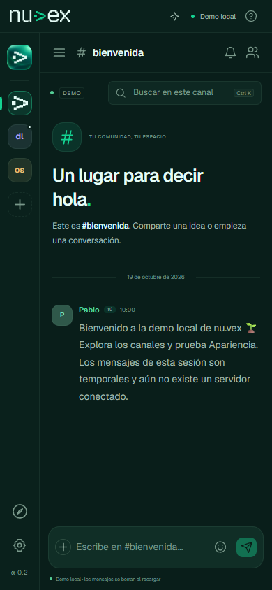
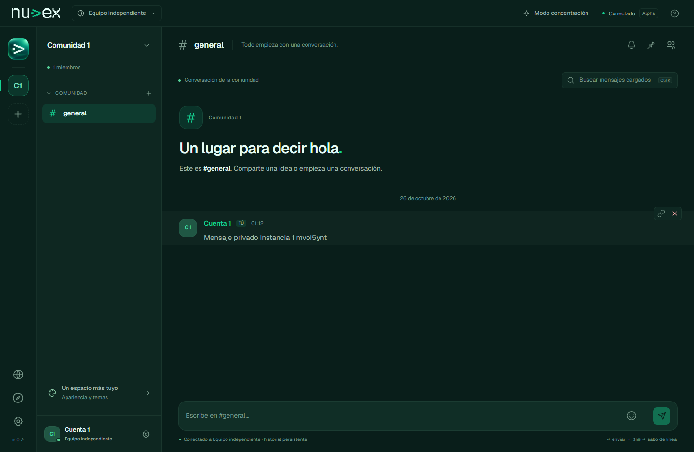

# Interfaz y varias instancias

[Inicio](../README.md) · [English](en/README.md)

Cambios de esta rama, 26 de octubre de 2026. Creado por Pablo / ImPaul17. Pre-release Alpha.

## Una conversación con más espacio

Se retira el banner decorativo de comunidad y se amplía la tipografía de canales, mensajes, búsqueda y controles. El panel de miembros aparece al solicitarlo. Las categorías se pueden plegar y el modo concentración oculta la navegación para dejar más espacio al chat.

La navegación móvil mantiene el panel de canales como un diálogo lateral con foco controlado. La apariencia conserva Bosque, Medianoche y Luz de día; la marca mantiene sus colores originales.

## Cambiar de instancia

En web, **Tus instancias** permite elegir un servidor ya conocido o añadir uno nuevo. Se guardan hasta seis direcciones validadas; las sesiones de esos servidores permanecen separadas en memoria. Al cambiar se cierra el WebSocket activo y se vuelve a cargar el espacio del destino. Solo la instancia seleccionada recibe eventos en esa pestaña.

Cerrar sesión revoca únicamente la cuenta actual. Una recarga elimina las credenciales remotas de memoria. La sesión del mismo origen puede recuperarse mediante su cookie.

En escritorio, el transporte Rust sigue admitiendo **una conexión por ventana**. Cambiar de servidor requiere volver a iniciar sesión. El selector conserva direcciones, pero no anuncia ni intenta reutilizar handles nativos invalidados. Ampliar el mediador para conservar varias sesiones nativas requiere una decisión y pruebas propias.

## Verificación realizada

- Svelte y TypeScript: sin errores ni avisos.
- Modelos, temas y direcciones guardadas: 14 pruebas correctas.
- Navegador Edge: seis escenarios de demo correctos, incluidos móvil y tres temas.
- Dos servidores Rust con bases PostgreSQL diferentes: ocho escenarios de instancia correctos.
- Build estático y verificación de licencias incluidos en la exportación web.

Las pruebas de instancia verifican cuentas, invitaciones, historial, revocación, reconexión y respuestas tardías. El nuevo escenario comprueba que alternar instancias no mezcla mensajes y que cerrar una cuenta no cierra la otra.

No se ha recompilado ni probado interactivamente Tauri con estos cambios. La cobertura del navegador no sustituye esa prueba. Las capturas iniciales de esta página corresponden a la interfaz de texto; la voz posterior tiene [su guía, capturas y pruebas](voice.md). Archivos compartidos, privados y moderación avanzada siguen pendientes en la [hoja de ruta](roadmap.md).
