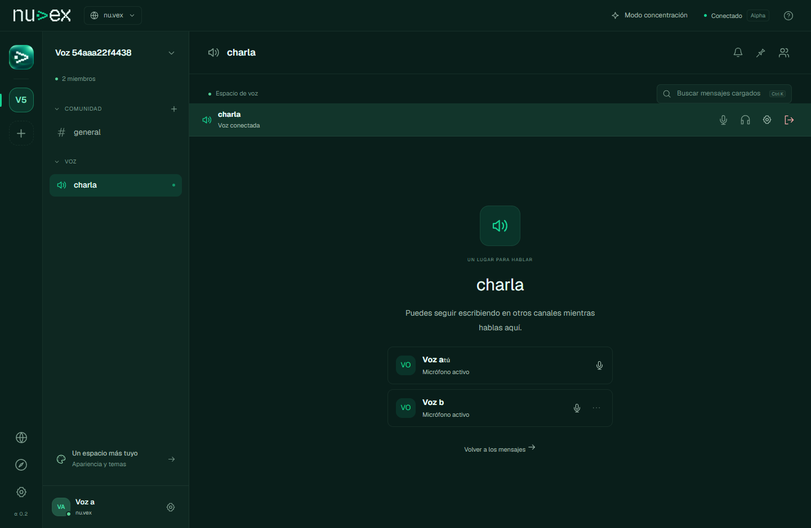
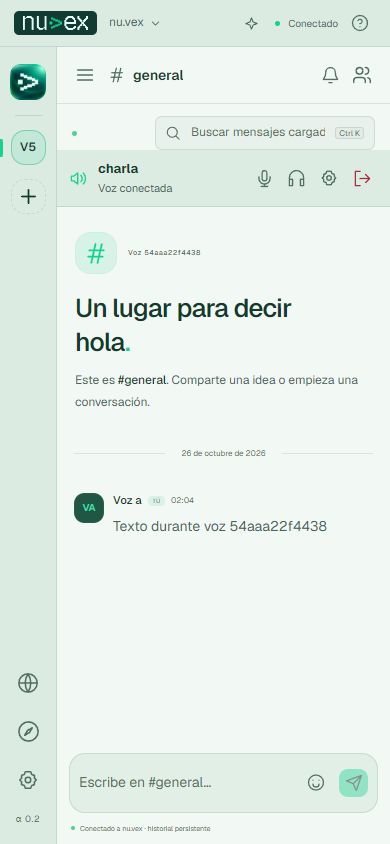

# Canales de voz

[Inicio](../README.md) · [Investigación de Discord con REA](research/discord-voice.md)

Los canales de voz están disponibles en la [web Alpha](https://nuvex-alpha.pablomerino2008.workers.dev). Crea un canal de tipo **Voz**, ábrelo y pulsa **Unirme al canal de voz**. La versión del instalador publicada anteriormente no contiene estos cambios.



## Diseño

Los canales de voz pertenecen a una comunidad y requieren una cuenta con membresía vigente. Entrar debe ser una acción explícita: el navegador pide acceso al micrófono al pulsar **Unirme al canal de voz**. Se puede seguir escribiendo en un canal de texto durante la llamada. Salir, cerrar sesión o cambiar de instancia libera los dispositivos y las conexiones.

La primera integración usa audio WebRTC entre participantes, con un máximo de ocho personas por canal. La señalización usa la API autenticada y el WebSocket existente de Nuvex. El audio se transmite por las conexiones WebRTC; los mensajes de señalización no se guardan en el historial de texto.

Los identificadores de participación son temporales y pertenecen a la sesión autenticada. La autorización del servidor se aplica al entrar, actualizar el estado y enviar señales. Los participantes deben renovar su presencia; la expulsión y el cierre de sesión retiran la participación.

## Controles

- Micrófono silenciado y escucha desactivada son estados distintos.
- La lista del canal muestra quién está conectado.
- Cada persona puede ajustar el volumen global o silenciar y ajustar a otra persona solo para su propia escucha.
- La selección de entrada y salida depende de las capacidades del navegador.
- El usuario puede abandonar la llamada sin cerrar el chat.
- La demo no captura audio ni simula una conexión real.

## Conectividad

Cloudflare sirve la web y conecta su API con la instancia. El túnel HTTP de la API no transporta el audio entre navegadores. WebRTC utiliza ICE para negociar la ruta multimedia.

El servidor STUN de referencia es `stun:stun.cloudflare.com:3478`, publicado en la [documentación oficial de Cloudflare](https://developers.cloudflare.com/realtime/turn/). Redes con NAT o cortafuegos restrictivos pueden requerir un relay TURN. La configuración de ICE debe suministrarla el operador del servidor; las claves de administración permanecen en el servidor y fuera de la compilación web.

La instancia publicada usa STUN; todavía no tiene un relay TURN configurado. En la conexión directa, los participantes negocian rutas de red entre sí. La llamada termina al perder la conexión con la instancia y puede iniciarse de nuevo cuando se recupere.

La [guía de WebRTC](https://webrtc.org/getting-started/peer-connections) explica la separación entre señalización y conexiones multimedia. Un SFU para grupos grandes, relay TURN operado y pruebas entre redes físicas diferentes son entregables adicionales. La prueba con dos navegadores en un mismo ordenador no demuestra conectividad en todas las redes.

## Verificación

```powershell
$env:PLAYWRIGHT_CHANNEL = 'msedge'
npm run test:voice
```

La suite de voz utiliza un dispositivo de audio sintético del navegador. Comprueba paquetes de audio recibidos en ambas direcciones mediante las estadísticas WebRTC, controles de micrófono/escucha, texto durante la llamada, revocación y liberación de pistas. Nunca utiliza el micrófono físico para estas pruebas.

Resultado del 26 de octubre: **dos escenarios locales correctos en 7,8 s y dos escenarios públicos correctos en 10,4 s**, con Edge. Las pruebas públicas usan el Worker, la API y PostgreSQL reales; también verifican creación desde la interfaz, rechazo de personas ajenas, identidad del participante y permiso de micrófono denegado. Se revisaron los tres temas y el ancho móvil de 390 px. Los clientes de audio se ejecutaron en un mismo ordenador.



La compilación, la migración de canales y las pruebas contra el despliegue público deben quedar registradas en [verificación](verification-current.md). El análisis de Discord distingue las funciones observadas en sus artefactos de las decisiones propias de Nuvex; no demuestra equivalencia completa entre ambos productos.
