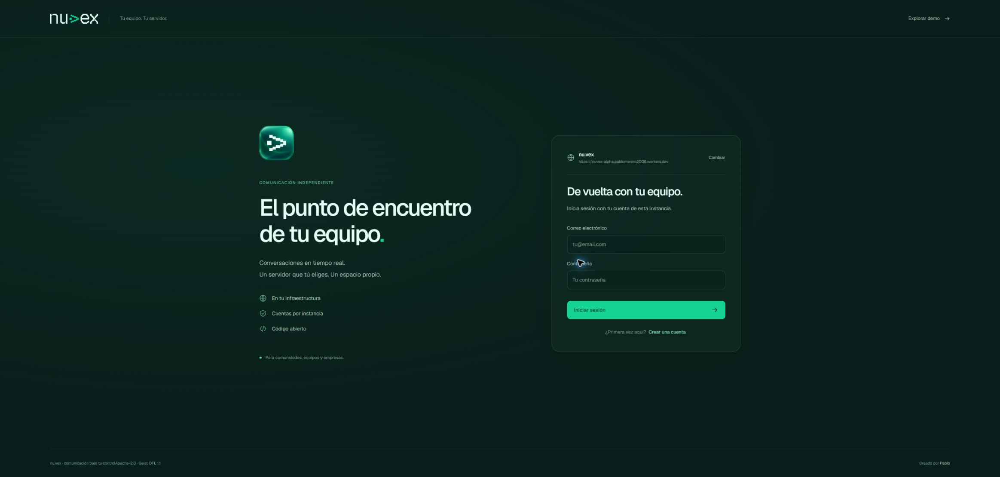

# Despliegue propio en Cloudflare

[Inicio](../README.md) · [English](en/README.md)

Cliente web Alpha: [nuvex-alpha.pablomerino2008.workers.dev](https://nuvex-alpha.pablomerino2008.workers.dev).



La dirección pertenece al despliegue de la cuenta propia de Cloudflare. El cliente y el recorrido Worker → VPC → API están activos: las rutas públicas de salud y de información de instancia responden **200**. El conector también confirma disponibilidad mediante su ruta local `/ready`.

Versión actual del Worker: `06f864db-46de-4283-bca5-a51161fb7450`. **Las dos pruebas públicas de voz pasaron en Edge en 10,4 segundos.** La aceptación inicial del servicio había pasado cuatro escenarios en 17,2 segundos y un reinicio real de Axum, conservando sesión, membresía e historial. Los resultados se registran por fase en [verificación](verification-current.md).

## Arquitectura y estado

```text
Navegador → Worker y archivos estáticos en Cloudflare
                       ↓ binding NUVEX_API
                 Servicio HTTP Workers VPC
                       ↓ túnel privado
PC: Axum 127.0.0.1:3003 → PostgreSQL 127.0.0.1:55433
```

| Recurso | Configuración real | Estado |
| --- | --- | --- |
| Worker | `nuvex-alpha` · dirección workers.dev indicada arriba | Publicado; salud e información de instancia responden 200 |
| Túnel privado | `nuvex-central-pc` | Conector activo y `/ready` correcto; PID en el estado privado |
| Servicio VPC | `nuvex-central-api` → `127.0.0.1:3003` | Vinculado como `NUVEX_API`; HTTP y WebSocket públicos comprobados |
| Axum | `127.0.0.1:3003` | Listo con voz, origen HTTPS exacto y registro abierto; PID en `backend.json` |
| PostgreSQL | `127.0.0.1:55433/nuvexcentral` | Clúster propio migrado, separado de pruebas; entrega con cero cuentas y cero mensajes |
| Copia/restauración con voz | `nuvexcentral_restore_20261026_50dce431c93a` | Cuatro cuentas y un mensaje sintéticos recuperados con dos migraciones; origen sin modificar |

`wrangler.jsonc` conserva la configuración del Worker y el identificador real del servicio VPC. El Worker sirve `/api/v1/` y las rutas de salud mediante el binding; los demás recursos se sirven como archivos estáticos con navegación de aplicación de una sola página.

El túnel privado alcanza Axum sin publicar PostgreSQL ni abrir un puerto entrante del router. El backend sigue siendo Rust/Axum con PostgreSQL: esta publicación no introduce otro servidor de cuentas ni sustituye la base por D1. Workers VPC está en beta. [Static Assets](https://developers.cloudflare.com/workers/static-assets/), [Workers VPC](https://developers.cloudflare.com/workers-vpc/get-started/).

## Compilar y publicar el cliente

Desde la raíz del repositorio:

```sh
npx --yes npm@11.21.1 ci
npm run check
npm test
npm run test:cloudflare
npm run web:export
npm run cloudflare:deploy
```

`web:export` ejecuta `scripts/export-cloudflare.mjs`, verifica el build y sus avisos legales y prepara los archivos en `.cache/cloudflare/web`. Genera una CSP con hashes del arranque del cliente y mantiene fuentes y código locales. El despliegue usa Wrangler 4.152.0, fijado en el comando del proyecto.

El cliente usa su mismo origen para acceder a la API. La exportación admite una lista explícita de destinos adicionales mediante `NUVEX_CONNECT_ORIGINS`; no introduce comodines para conectar con cualquier servidor. Cada destino externo también debe aceptar el origen del cliente en su configuración de servidor. Consulta [autoalojamiento](self-hosting.md).

La autenticación de Wrangler se realiza en la cuenta propia. No introduzcas tokens, claves de túnel ni contraseñas en `wrangler.jsonc`, Git, variables públicas de compilación o registros.

## Operar la instancia del PC

La [guía de instancia local](local-instance.md) describe los destinos, permisos y comprobaciones de los scripts.

Los scripts de `scripts/instance/` requieren **PowerShell 7 (`pwsh`)**. Ejecuta los siguientes comandos desde una sesión de esa versión.

Preparar o reutilizar el clúster y aplicar migraciones:

```powershell
./scripts/instance/init-central.ps1
```

Iniciar el backend con la configuración actual, después de comprobar el origen:

```powershell
./scripts/instance/start-central.ps1 -AllowedOrigin 'https://nuvex-alpha.pablomerino2008.workers.dev' -RegistrationOpen $true
```

El inicio es oculto. El modo inseguro está desactivado y la confianza de proxy se limita a `127.0.0.1/32`. El PID y los registros quedan bajo el directorio privado de servicio. Cambiar el origen o el estado de registro de un proceso en ejecución requiere revisar y detener su PID antes de iniciar la nueva configuración; el script no reemplaza procesos ajenos.

Iniciar o reutilizar el conector privado:

```powershell
./scripts/instance/start-tunnel.ps1
```

Este es el script usado para el conector activo de `nuvex-central-pc`. Valida el ejecutable fijado de cloudflared, su suma SHA-256, la identidad del proceso y el archivo de credencial protegido; no pasa la clave como argumento ni la escribe en registros. Confirma `/ready` en `http://127.0.0.1:20263/ready`. El PID es un dato de ejecución: consulta el estado privado en lugar de suponer que conserva el mismo número después de un reinicio.

El proxy conserva Origin y credenciales para que Axum aplique su política exacta. Las pruebas públicas comprobaron cookies, tickets y WebSocket a través de este recorrido. La aceptación completa está registrada por separado de la disponibilidad local.

## Base de datos, copias y recuperación

Los datos de servicio viven en `.cache/central-instance/data`, con la base `nuvexcentral` y el rol restringido `nuvex_app`. No se reutiliza el clúster de las pruebas. Las credenciales administrativas y de aplicación son distintas, se generan criptográficamente y permanecen en el directorio local con ACL protegida para el usuario autorizado.

La copia y la comprobación de restauración se ejecutan así:

```powershell
$nuvexBackup = ./scripts/instance/backup-central.ps1 | ConvertFrom-Json
./scripts/instance/test-restore-central.ps1 -Archive $nuvexBackup.archive
```

El verificador solo crea una base nueva con prefijo `nuvexcentral_restore_`; no sobrescribe ni borra bases existentes. Después de la primera prueba con base vacía, una segunda copia recuperó los datos sintéticos usados en las pruebas públicas: **cuatro cuentas y cuatro mensajes** en `nuvexcentral_restore_20261026_9b76e3f230fb`. El esquema, las huellas y los recuentos coinciden; el comprobante registra `sourceModified: false`. La transacción adicional de cuenta y mensaje sintéticos también se revirtió.

La restauración se realizó en una base apartada y conservada para inspección. Estas verificaciones demuestran recuperación de esos datos sintéticos; no se presentan como una prueba con conversaciones reales de usuarios. Los archivos, claves y comprobantes permanecen en el directorio privado ignorado por Git.

Antes de la entrega se guardó otra copia con los datos de las trece cuentas sintéticas de validación. Después se retiraron únicamente esos trece fixtures propios, identificados de forma exacta y con comprobaciones de sus relaciones. La base de servicio queda con **cero cuentas y cero mensajes**. La cuenta y la comunidad personales de Pablo no se han creado mediante credenciales inventadas: su registro y creación siguen pendientes del flujo real del usuario.

## Disponibilidad

Mientras Axum y PostgreSQL estén en el PC, las cuentas y conversaciones dependen de que **el ordenador permanezca encendido, conectado a Internet y con PostgreSQL, Axum y `cloudflared` en ejecución**. Si se apaga o suspende, los archivos del cliente seguirán alojados en Cloudflare, pero su API dejará de estar disponible.

**No se ha instalado un servicio de Windows ni una tarea de inicio automático.** Después de reiniciar el PC hay que iniciar el clúster, el backend y el conector con los scripts anteriores desde PowerShell 7. La prueba realizada reinició el proceso de Axum; no fue un reinicio completo del ordenador ni una prueba de arranque automático.

La dirección estable del Worker no implica operación continua del servidor local. Se puede trasladar posteriormente el mismo backend y su base a una máquina siempre disponible. Un Quick Tunnel con hostname aleatorio `trycloudflare.com` no es el mecanismo elegido para este despliegue. [Quick Tunnels](https://developers.cloudflare.com/tunnel/get-started/quick-tunnels/).

## Verificación y aceptación

La primera ejecución pública confirmó recuperación del historial y revocación de acceso por WebSocket. En las pruebas de latencia se detectó que la pantalla de acceso permitía elegir el registro antes de resolver la restauración de sesión; una respuesta 401 tardía podía devolver la vista al inicio de sesión. La corrección `2367978` espera esa restauración antes de mostrar los controles. Su prueba de regresión con un 401 real falla con el comportamiento anterior y pasa después de corregirlo; el cliente se volvió a exportar y publicar.

La última ejecución conjunta de **cuatro escenarios públicos pasó en Edge en 17,2 segundos** después de aplicar `2367978` y publicar la versión del Worker indicada. Cubrió registro e inicio de sesión, invitaciones y dos cuentas con mensajes bidireccionales por WebSocket, persistencia al recargar, revocación de acceso y las regresiones de restauración y del formulario ante un 401 tardío.

Además se reinició el proceso propio de Axum y se comprobó, desde la API pública, que la misma cookie seguía recuperando la cuenta, su membresía y el mensaje persistido. El conector siguió activo durante el reinicio. Los PID actuales se consultan en el estado privado. Los comprobantes de reinicio, copia/restauración y limpieza se conservan allí; no se incorporan a Git cookies, credenciales ni trazas de acceso.

La ampliación de voz se publicó después como Worker `06f864db-46de-4283-bca5-a51161fb7450`. La API aplica dos migraciones y las dos pruebas públicas de voz pasaron en 10,4 s: audio WebRTC bidireccional, permisos, controles locales y retirada de acceso. Se comprobó otra restauración con los datos de esas pruebas antes de retirarlos. Consulta [voz](voice.md) y [verificación](verification-current.md).

Sigue pendiente establecer la cuenta y comunidad de Pablo mediante un flujo real de acceso. Las cuentas sintéticas de aceptación ya se retiraron y no representan su cuenta personal.

Todas las entregas continúan como **pre-release Alpha**. Voz es una malla de hasta ocho personas con STUN; TURN, SFU y aceptación en redes distintas quedan pendientes. Privados, amistades, roles avanzados, vídeo, archivos compartidos, proveedores externos, actualizaciones automáticas y apps móviles nativas siguen en la [hoja de ruta](roadmap.md).
